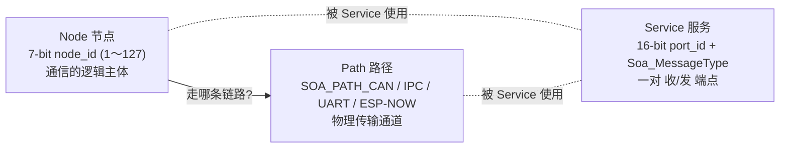
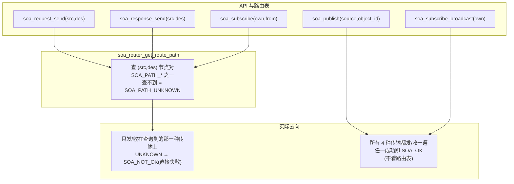

# SOP / SOA — Service Oriented Protocol（面向服务的协议）

SOP 本目录 (`main/soa/Sop/`) 是一个**通信中间件**：它把"谁和谁通信（node）"、
"走哪条物理链路（path / transport）"、"通什么信（service / port）"三个概念解耦，
上层业务只用统一的 C API 收发消息，底层可以在 CAN、IPC、UART、ESP-NOW 之间切换
而不用改业务代码。

## 三个概念




- **Node（节点）**：一个逻辑通信主体，用 7-bit `node_id`（1～127）标识，例如
  `MASTER_NODE_ID=2`（中央控制器）、`HUI_NODE_ID=6`（本板 AI 音箱）、
  `BCM_NODE_ID=4`、`MCU_NODE_ID=5`、`BMS_NODE_ID=7`。每个 node 通过
  `soa_create_node(node_id, Soa_NodeType)` 登记到**某一种**传输上。
  号段规则：1～63 功能节点，64～127 预留给诊断节点（诊断不复用功能节点号）。
- **Path（路径）**：一种物理传输通道，即 `Soa_PathType`：
  `SOA_PATH_CAN=0`、`SOA_PATH_IPC=1`、`SOA_PATH_UART=2`、`SOA_PATH_ESPNOW=3`。
  路由表按 **(node 对)** 记录用哪条 path —— 两个节点之间走 CAN 还是走 ESP-NOW，
  是配置出来的，不是硬编码的。
- **Service（服务）**：一次通信的"端点"，由 16-bit `port_id` + `Soa_MessageType`
  标识（`SoaBroadcast=0 / SoaResponse=1 / SoaRequest=2`），以
  `message_service_callback` 回调的形式挂接到代码里。三个回调入口分别对应
  发布/订阅、请求、应答三种交互模式。

## 通信模式与路由表

三种 API 与路由表的关系**不完全对称**，这是本实现最容易踩坑的地方：



| API | 用路由表？ | 含义 |
|---|---|---|
| `soa_request_send(src, des, service_id, ...)` | ✅ 走 `(src,des)` 查到的 path | 客户端发起一次服务调用 |
| `soa_response_send(src, des, service_id, ...)` | ✅ 同上 | 服务端回一次响应 |
| `soa_subscribe(own, from, type, expect_id, ...)` | ✅ 走 `(own,from)` 查到的 path | 点对点订阅，必须在**先建路由**之后调用，否则返回 `SOA_NOT_OK` |
| `soa_publish(source, object_id, ...)` | ❌ 广撒到全部传输 | 广播发布（canard port = `object_id`） |
| `soa_subscribe_broadcast(own, type, expect_id, ...)` | ❌ 在全部传输上挂回调 | 广播订阅 |

所以：**请求/应答和点对点订阅一定要先 `soa_create_route_path(a, b, path)`**；
广播则天生跨传输（在每种已初始化的传输上各发/收一次）。

## 本仓库中的典型接线

```c
soa_init();                                          /* 初始化全部传输 */
soa_create_node(HUI_NODE_ID, SOA_NODE_ESPNOW);       /* id=6 登记到 ESP-NOW */
soa_create_route_path(HUI_NODE_ID, MASTER_NODE_ID,   /* (6,2) 这对节点 */
                      SOA_PATH_ESPNOW);              /* 走 ESP-NOW */
soa_subscribe_broadcast(HUI_NODE_ID, SoaBroadcast,
                        6152u, sizeof(HostHeartbeat), on_host_heartbeat);
HuiRpc 系列内部调用 soa_request_send(HUI_NODE_ID, MASTER_NODE_ID, 301/302/303, ...)
```